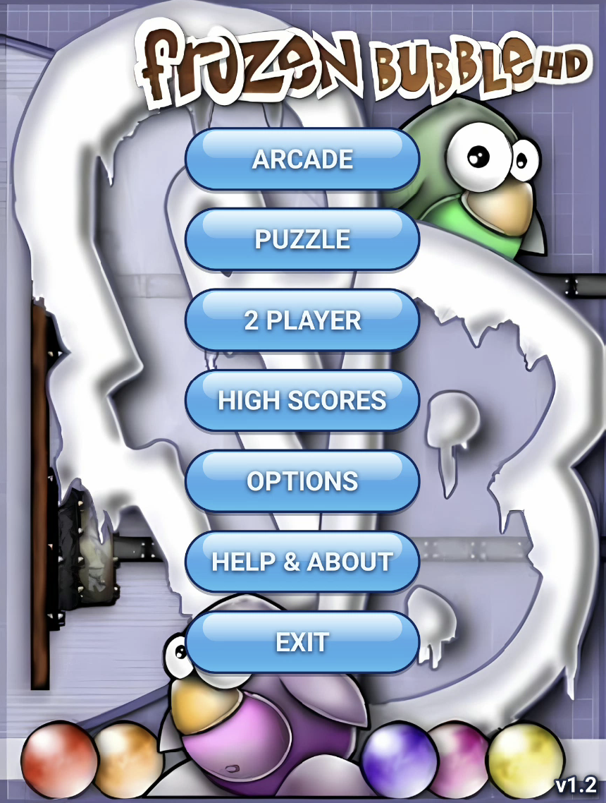
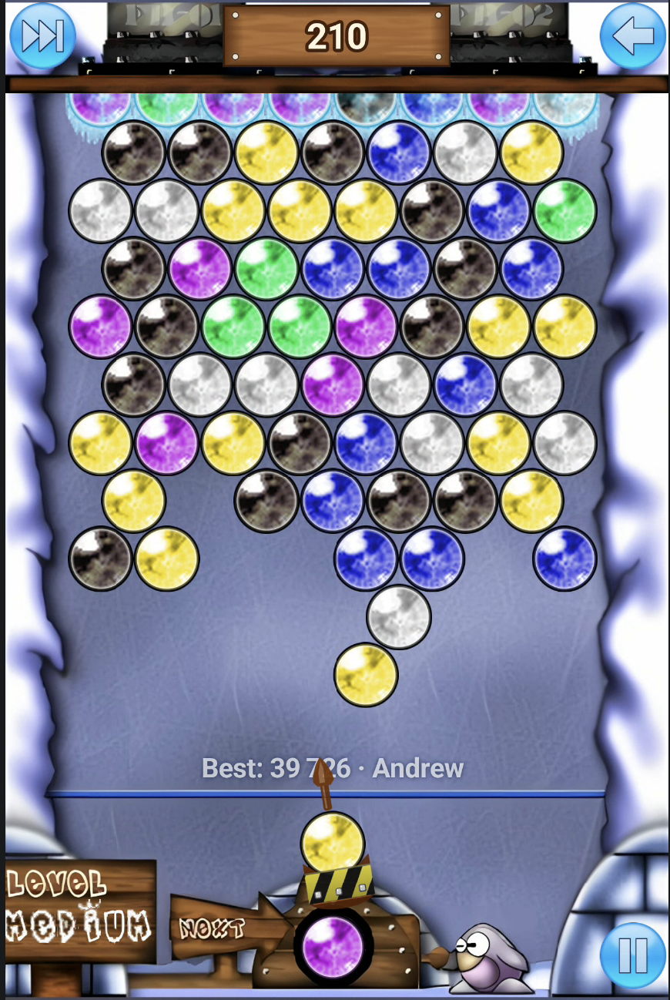
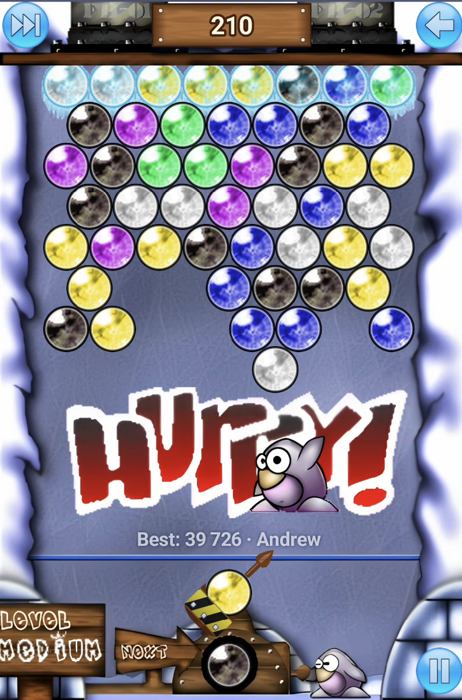
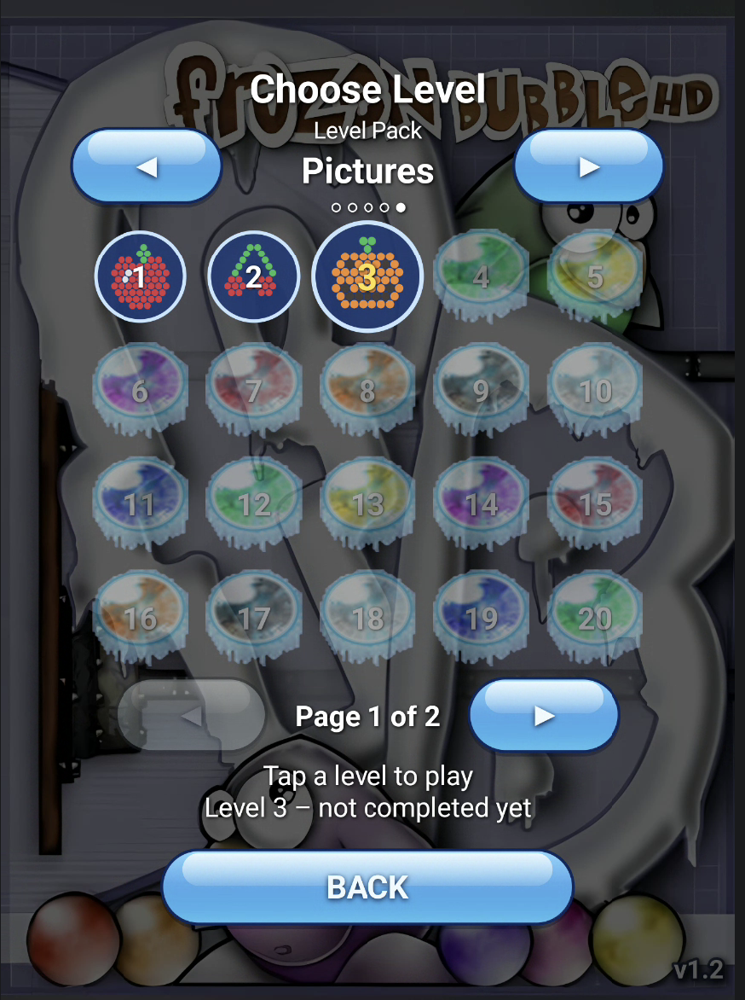
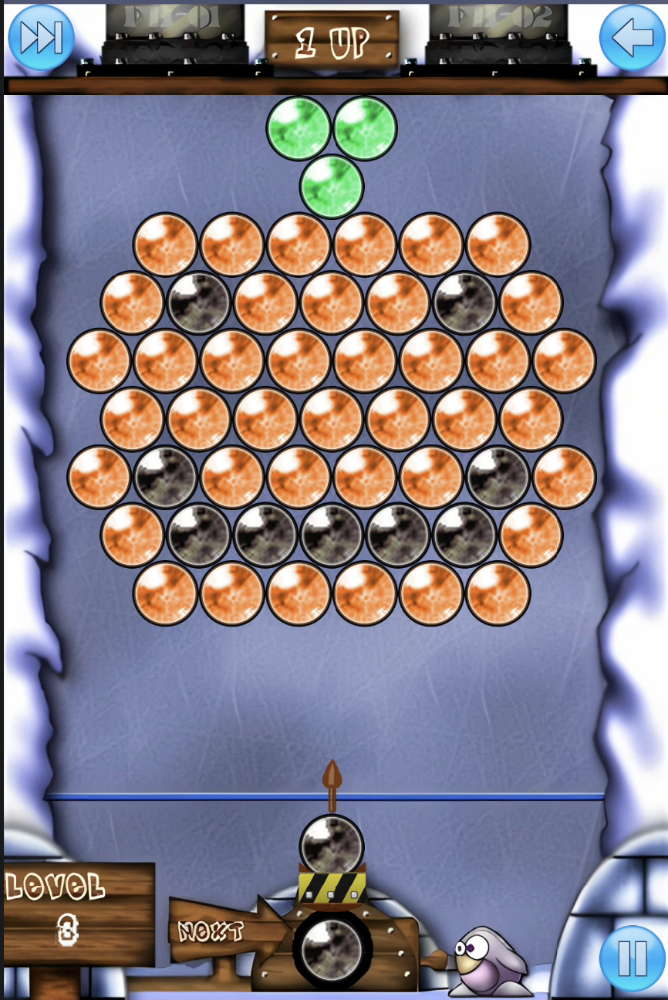
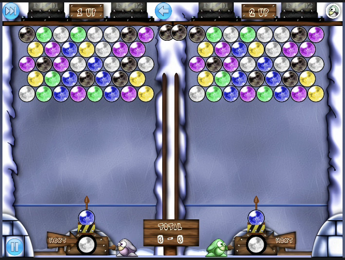
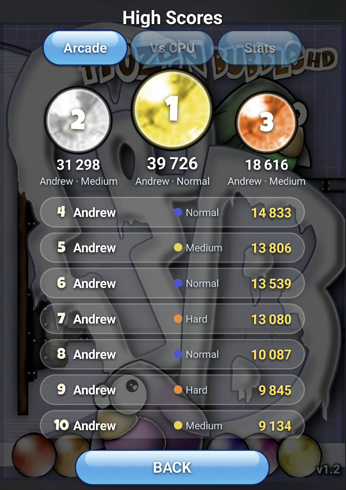

# Frozen Bubble HD for Android

The Android port of the Frozen Bubble game, brought up to date for
Android 16 with HD art, new menus, level packs, Arcade scoring and more.

This fork diverged from the original project,
[videogameboy76/frozenbubbleandroid](https://github.com/videogameboy76/frozenbubbleandroid),
at its `master` branch (commit `c3ac715`, April 2020, version 4.4).

- **What's new:** [docs/CHANGES.md](docs/CHANGES.md)
- **Building:** [docs/BUILDING.md](docs/BUILDING.md)
- **Level packs and level tools:** [docs/LEVEL_PACKS.md](docs/LEVEL_PACKS.md)
- **Deprecated Android APIs (work list):** [docs/DEPRECATIONS.md](docs/DEPRECATIONS.md)

## Screenshots

<table>
<tr>
<td align="center"> Home screen</td>
<td align="center"> Arcade</td>
<td align="center"> Arcade: hurry!</td>
<td align="center"> Choose Level</td>
</tr>
<tr>
<td align="center"> Puzzle: Pictures pack</td>
<td align="center"> 2 Player</td>
<td align="center"> High Scores</td>
</tr>
</table>

## Why this port

I have ADHD, and Frozen Bubble has been on my phone for more than 15
years: a wonderfully simple alternative to doom scrolling.  It's rare to
find anything on an app store these days that is fun and not littered
with bloatware and ads, and I wanted to keep this one going.

It started with wanting to play my own music in the game, from my
collection of MOD files.  Then I found that modern phones didn't scale
the picture well.  Eventually I was just having fun, and spending more
time tweaking and developing the game than playing it.

I know this has drifted quite a way from the original, which is why I
added "HD" to the name.  All the original licensing and restrictions are
preserved, and I'm open to pull requests and merges from the community.
I built this mainly for myself, but in the spirit of free and open
source software, I've set it free.

— Drew Baker

## Highlights

- Android 16 (targetSdk 36), minSdk 24 (Android 7.0); edge to edge, smooth
  on 90/120 Hz screens, no deprecated API warnings.
- HD art at 4x throughout (the original art is an option).
- Bubble-style menus and grouped Options, a first-start setup, and seven
  languages.
- Puzzle: a Choose Level screen with level previews, and four new level
  packs (Easy, Medium, Hard, Pictures) beside the original 100 levels.
- Arcade: points, combos and a difficulty multiplier on one leaderboard, a
  live score and a game over summary.
- 2 Player: Vs CPU with four skill levels; Bluetooth and Wi-Fi fixes.
- Your own music folder (`.mod`, `.xm`, `.it`, `.s3m`, and AdLib `.rol`
  songs with their `.bnk` instrument banks), a next-song
  button, a podium High Scores screen, and optional effects.

## Building

Open the folder in Android Studio, let Gradle sync, then Run 'app'.  Built
with Android Gradle Plugin 9.4, Gradle 9.6, Java 17; the libmodplug music
player is built with CMake from `app/src/main/cpp`.  See
[docs/BUILDING.md](docs/BUILDING.md) for terminal builds.

## Download

Frozen Bubble HD is not in any app store yet.  Signed APKs will be on
this repository's
[Releases page](https://github.com/dotelpenguin/frozenbubbleandroid/releases);
to install one, allow your browser or file manager to "Install unknown
apps".  The [Obtainium](https://github.com/ImranR98/Obtainium) app can
watch the Releases page and keep the game up to date.  Or build it
yourself (see [Building](#building)).

Frozen Bubble HD has its own application ID
(`io.github.dotelpenguin.frozenbubblehd`), so it installs beside the
original Frozen Bubble rather than replacing it.

## History

Originally developed with SDK v20.1.0, using API level 4 (version 1.6
Donut), later with SDK v25.2.5 and NDK r10e using API level 12.

The original Frozen Bubble for Android (`org.jfedor.frozenbubble`) is a
separate app, published by its own developer, and is still available on
[F-Droid](https://f-droid.org/packages/org.jfedor.frozenbubble/) (version
4.4, 2017) and
[Google Play](https://play.google.com/store/apps/details?id=org.jfedor.frozenbubble).
Those are not Frozen Bubble HD.

## Credits and licence

The code is based on the Java version of Frozen Bubble created by Glenn Sanson.
The original Frozen Bubble was created by Guillaume Cottenceau (programming),
Alexis Younes and Amaury Amblard-Ladurantie (artwork) and Matthias Le Bidan
(soundtrack).

The Android port was initially created by Pawel Aleksander Fedorynski, with
additional development provided by Eric Fortin.  The 2026 modernization
was done by Drew Baker.  Titles use the Luckiest Guy font by Astigmatic
(Apache License 2.0, `app/src/main/assets/fonts`).

This code is distributed under the GNU General Public License.

This program is free software; you can redistribute it and/or modify it under
the terms of the GNU General Public License version 2 or 3, as published by the
Free Software Foundation.

This program is distributed in the hope that it will be useful, but WITHOUT ANY
WARRANTY; without even the implied warranty of MERCHANTABILITY or FITNESS FOR A
PARTICULAR PURPOSE.  See the GNU General Public License for more details.

You should have received a copy of the GNU General Public License along with
this program; if not, write to:
Free Software Foundation, Inc.
675 Mass Ave
Cambridge, MA 02139, USA
